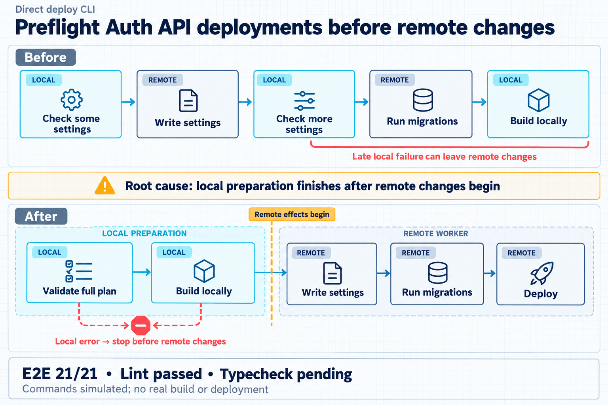

# Preflight Auth API deployments before remote changes



The direct deploy CLI mixed local checks with remote changes. A late validation or build failure could stop the command after settings or migrations changed remotely. The local correction validates the full plan and completes the build before writing remote settings, running migrations, and deploying.

The Before track marks each step as local or remote to expose the mixed ordering. The After track groups validation and build on the local side of an amber boundary. A local error stops before remote effects begin. Remote operations remain sequential. There is no rollback or atomicity guarantee.

The official test wrapper already validates required settings. This illustration describes the direct deploy CLI.

## Evidence and limits

The independent review reports E2E 21/21 and Biome exit 0 with no errors or warnings. Command effects, build, Wrangler, and the FCM parser were simulated. No real build or deployment ran. No occurrence frequency was measured.

The official Node typecheck did not start. Dependency preparation aborted under the available local memory budget. This is a verification gap, not a demonstrated TypeScript error. The unit has no final overall approval.

The sources are the existing project records, read on 26 October 2026.

- `reviews/deploy-preflight-final.md`, SHA-256 `72F64C8314FD77011AF6C543FAC5F6DD730FB1EBB659A423BA552E55B120A546`.
- `validation/deploy-preflight-types.md`, SHA-256 `79F76E0709E502B800E607272EC4BB757A0B378B94D3E91A514B3B8FAB6E25E3`.

They describe the local patch against base `8822eb2c12602baecbd9b641fe8a4abfd2937ea0`. Their reported checks were not rerun for this illustration.

## Generation

The helper ran directly with Python from `tooling/`, returned JSON, and exited 0.

```text
python scripts/pr_infographic_prompt.py --title "Preflight Auth API deployments before remote changes" --summary "Validate all settings and finish the local build before remote settings, migrations and deployment. Use a clean geometric blueprint design for this alternative illustration." --docs "Independent E2E 21/21 and Biome passed. Official typecheck pending due to memory. All command effects simulated; no real build or production deployment. No rollback or atomicity guarantee." --json
```

The explicit request for visual diversity overrides the helper's default sumi-e theme for this variant. The helper was not edited.

Generation used the native `image_gen.imagegen` tool through the requested GPT Images route. The tool result does not expose a model version. No image API runner, image CLI, credential, or substitute drawing was used.

The original output is `exec-f12c79e5-429f-40c3-b789-38f75ca3695b.png`, in generation `01a179fc-18b0-7381-8bc8-cb908d4d8579`. It remains intact. The saved project copy is `artifacts/infographics/deploy-preflight/blueprint/infographic.png`. This report is beside that image.

The existing sumi-e image, its reports, earlier versions, and canonical root files were preserved. No code, worktree, validation record, GitHub content, publication, dependency, app, or service was changed.

## Visual and file inspection

The native image and final saved file were loaded for inspection. The design uses a light grid, geometric cards, distinct icons, navy/cyan local preparation, an amber boundary, and coral error connectors.

The Before track shows local checks mixed with remote settings and migration before the local build. The After track shows full-plan validation, local build, settings, migration, and deploy. Both local phases feed the stop before the remote boundary.

The evidence strip reads "E2E 21/21 • Lint passed • Typecheck pending". The next line reads "Commands simulated; no real build or deployment". Text is legible and correctly spelled. There is no global approval badge, passing typecheck claim, rollback loop, or atomicity claim.

The saved PNG is 1536 × 1024 pixels and 1,545,451 bytes. Its SHA-256 is `0779F97108FD424F5F9BE24FC199155D5B3915C6EFC833FDC6658A8F87277BB9`.

The Poteto principle Prove It Works led to inspection of the final artifact, dimensions, and hash. This verifies the illustration, while the project verification limits remain those recorded above.

## Final generation prompt

```text
Use case: infographic-diagram.
Generate a NEW wide horizontal technical editorial infographic, 1536x1024, for a GitHub PR. This is an alternative illustration for the direct Auth API deploy CLI. Use a clean geometric BLUEPRINT visual language on a very light cool-white background with a faint technical grid, disciplined typography, crisp geometric connectors, slim outlined cards, and ample whitespace. Navy text, cyan for LOCAL preparation, pale neutral navy for REMOTE steps, amber for the remote-effects boundary, coral for failure. Flat geometric symbols such as checklist squares, package/cube, configuration sliders, database cylinder and launch arrow. No sumi-e, ink brushwork, bamboo, washi, landscape illustration, gold ornament, or reuse of the earlier composition. This explicit design direction overrides the prompt helper's default Japanese style.

Main title in large dark navy type, exactly:
"Preflight Auth API deployments before remote changes"
Small context label:
"Direct deploy CLI"

Composition: two compared process tracks and a short causal sentence between them. Keep all arrows unmistakably ordered. Display all text large and sharp.

BEFORE track in upper half:
Label "Before".
Five equal cards in one left-to-right chain:
"Check some settings" → "Write settings" → "Check more settings" → "Run migrations" → "Build locally".
Give each card a small clearly legible domain tag, in this exact order:
"LOCAL", "REMOTE", "LOCAL", "REMOTE", "LOCAL".
Use cyan small accents for local cards and navy for remote cards. This mixed sequence intentionally crosses conceptual local/remote domains; do not draw a misleading fixed vertical domain boundary through this top track.
Use a coral warning bracket under the later validation and build, with concise text:
"Late local failure can leave remote changes"

Causal sentence between the two tracks, plain text with a small geometric amber warning icon:
"Root cause: local preparation finishes after remote changes begin"

AFTER track in lower half:
Label "After".
Five equal cards in one left-to-right chain:
"Validate full plan" → "Build locally" → "Write settings" → "Run migrations" → "Deploy".
First two cards are cyan-tinted, explicitly grouped under "LOCAL PREPARATION". Last three cards are pale navy-tinted, grouped under "REMOTE WORKER".
Draw a clear amber vertical boundary ONLY in this After track, located between "Build locally" and "Write settings", labelled "Remote effects begin".
From BOTH of the first two LOCAL cards only, a coral downward failure connector ends in a small stop symbol on the local side of the amber boundary. Caption:
"Local error → stop before remote changes".
The main forward path remains cyan/navy. No failure connector after the remote boundary and no rollback loop.

At the bottom, place a neutral editorial evidence strip, not a success/approval badge. Mandatory exact text, large and readable:
"E2E 21/21 • Lint passed • Typecheck pending"
Under it, also clearly readable, exactly:
"Commands simulated; no real build or deployment"

Factual constraints: Independent isolated tests passed 21/21 and Biome exited 0. The official typecheck did NOT start because dependency preparation aborted under the local memory budget. There is no final overall approval. Build/Wrangler/FCM effects and parser were synthetic; no real build or deployment ran. Remote valid operations are sequential without rollback guarantee or transaction atomicity. No measured failure frequency. The official test wrapper already validates required settings and is not the subject of this diagram. Do not draw it.

Do not add unprovided claims, benchmarks, checkmarks implying complete approval, passing typecheck text, seals, logos, watermarks, credentials, commands, personal paths or data. Preserve the exact mandatory evidence and simulation text. Prioritize clear architecture, cause and ordering over decoration.
```

